# 👋 Ciao, sono Francesco Autorino

📊 **Data Analyst** – diplomato al corso **Data Analytics & AI** di **EPICODE** (2 novembre 2026). 🎓

📍 Napoli, Italia · disponibile anche in **smart working**.

🌐 **[Visita il mio portfolio → portfoliofreautoda.netlify.app](https://portfoliofreautoda.netlify.app/)**

📄 **[Scarica il mio CV (PDF)](https://portfoliofreautoda.netlify.app/Francesco_Autorino_CV.pdf)**

🛠️ Uso **Excel · SQL · Python · Power BI · Looker Studio**.

💡 Mi piace partire da una domanda semplice e rispondere con i dati: pulizia, analisi e una dashboard facile da leggere.

---

---

## 🗂️ I miei progetti

⭐ In primo piano: il **Capstone** del corso EPICODE e il **Negozio online**.

🐱 L'ultimo fatto è **Gatti in rifugio**: amo i gatti, e ho voluto capire quali vengono adottati prima.

<table>
<tr>
<td width="50%" valign="top">
<a href="https://github.com/FreAuto/CapstoneProjectDataAnalystAutorinoEpicode">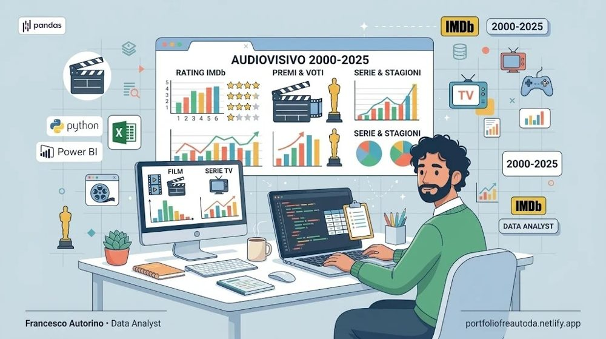</a>
 <b><a href="https://github.com/FreAuto/CapstoneProjectDataAnalystAutorinoEpicode">🎬 Capstone EPICODE</a></b> ❓ Il successo di film e serie 2000-2025: voti IMDb e premi 🛠️ Python · Power BI 📅 ottobre 2026
</td>
<td width="50%" valign="top">
<a href="https://github.com/FreAuto/NegozioOnlineAnalisiVendite">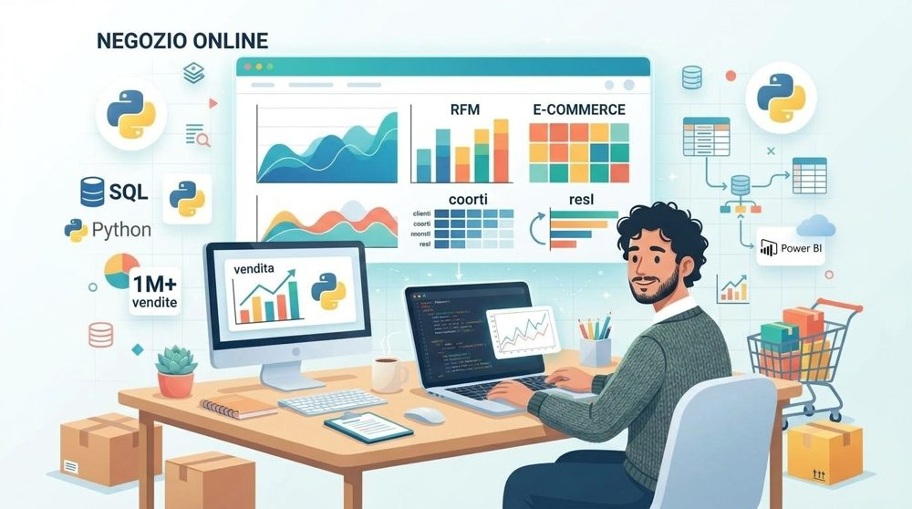</a>
 <b><a href="https://github.com/FreAuto/NegozioOnlineAnalisiVendite">🛒 Negozio online</a></b> ❓ Chi sono i clienti migliori di un e-commerce con 1 milione di vendite? 🛠️ SQL · Python · Power BI 📅 ottobre 2026
</td>
</tr>
<tr>
<td width="50%" valign="top">
<a href="https://github.com/FreAuto/GattiRifugioAnalisiAdozioni">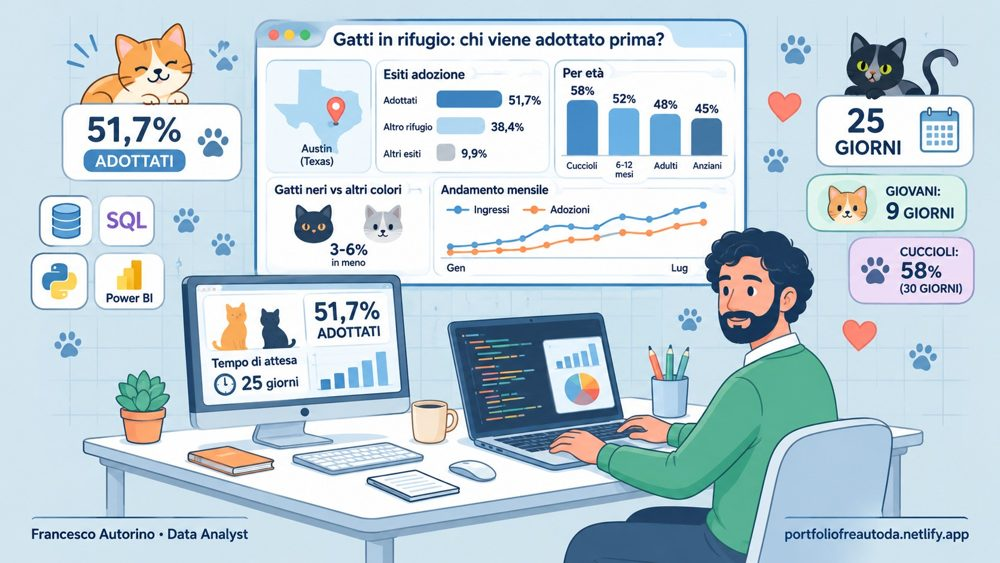</a>
 <b><a href="https://github.com/FreAuto/GattiRifugioAnalisiAdozioni">🐱 Gatti in rifugio</a></b> ❓ Quali gatti vengono adottati, e quanto aspettano? 69.313 ingressi in un rifugio 🛠️ SQL · Python · Power BI 📅 novembre 2026
</td>
<td width="50%" valign="top">
<a href="https://github.com/FreAuto/UsciteDipendentiAnalisiHR">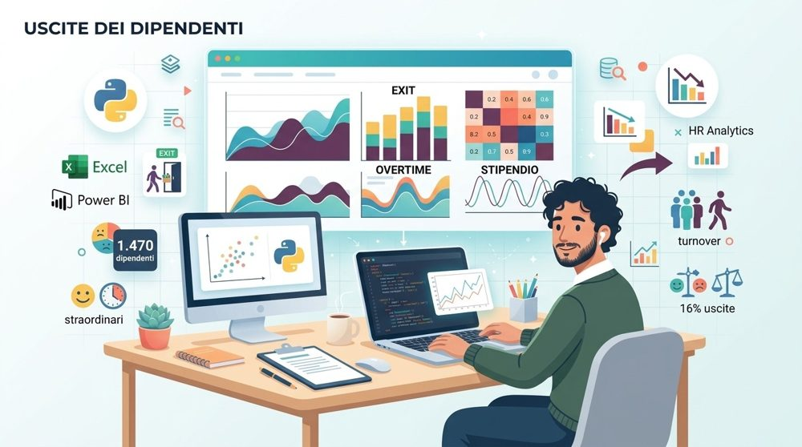</a>
 <b><a href="https://github.com/FreAuto/UsciteDipendentiAnalisiHR">👥 Uscite dei dipendenti</a></b> ❓ Perché i dipendenti lasciano l'azienda? 🛠️ Excel · Python · Power BI 📅 ottobre 2026
</td>
</tr>
<tr>
<td width="50%" valign="top">
<a href="https://github.com/FreAuto/AppleRicaviAnalisi">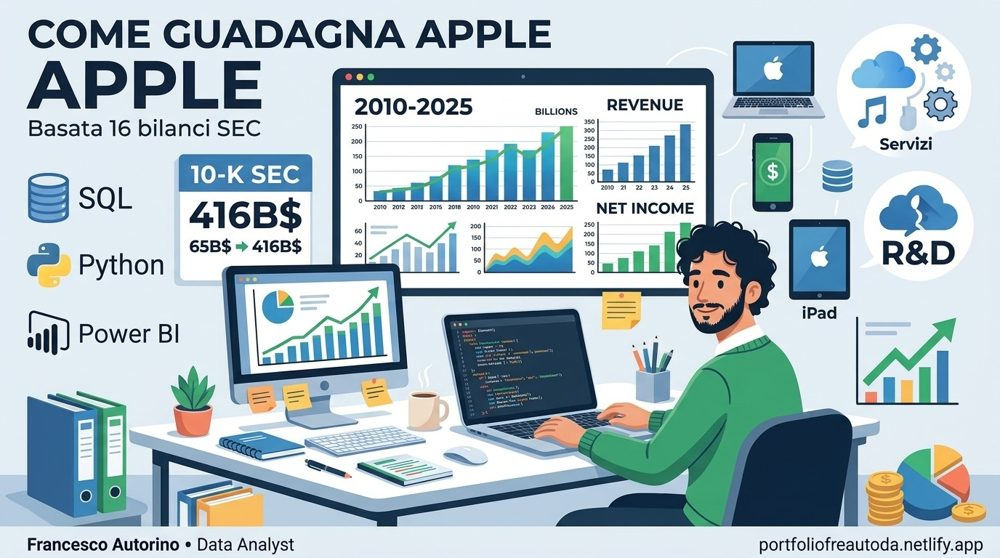</a>
 <b><a href="https://github.com/FreAuto/AppleRicaviAnalisi">🍏 Come guadagna Apple</a></b> ❓ Da dove arrivano i soldi di Apple, e come è cambiato in 15 anni? 🛠️ SQL · Python · Power BI 📅 ottobre 2026
</td>
<td width="50%" valign="top">
<a href="https://github.com/FreAuto/CarburantiAnalisiPrezzi">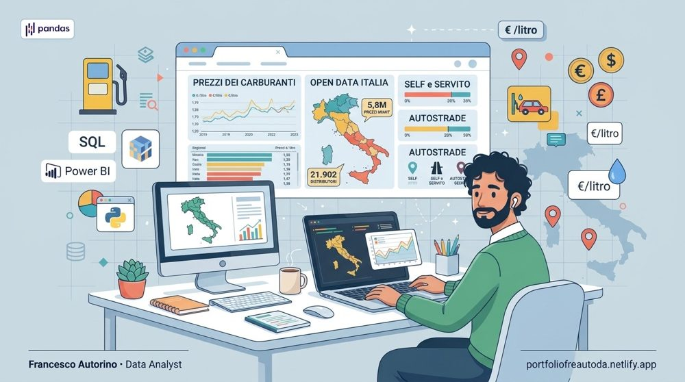</a>
 <b><a href="https://github.com/FreAuto/CarburantiAnalisiPrezzi">⛽ Prezzi dei carburanti</a></b> ❓ Quanto costa fare il pieno in Italia, e dove conviene? 🛠️ SQL · Power BI 📅 ottobre 2026
</td>
</tr>
<tr>
<td width="50%" valign="top">
<a href="https://github.com/FreAuto/CostoDellaVitaProvince">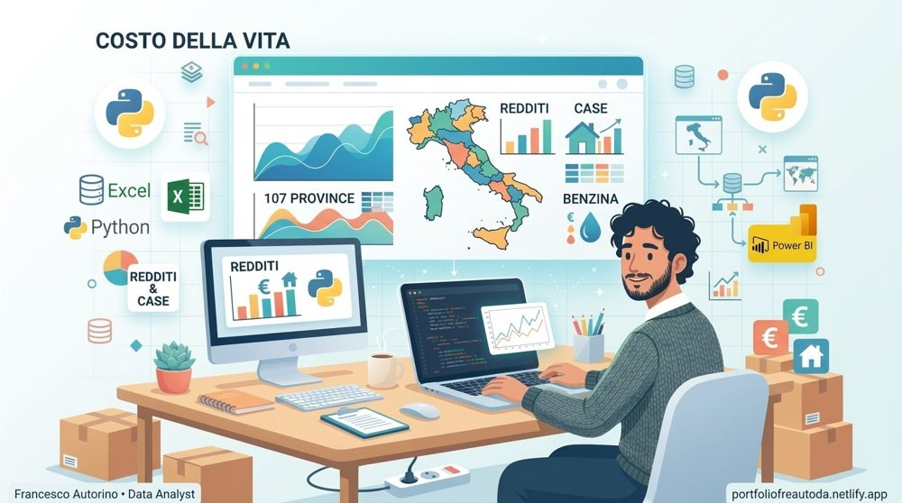</a>
 <b><a href="https://github.com/FreAuto/CostoDellaVitaProvince">🏙️ Costo della vita</a></b> ❓ In quale provincia lo stipendio rende di più? 🛠️ Python · Excel · Power BI 📅 ottobre 2026
</td>
<td width="50%" valign="top">
<a href="https://github.com/FreAuto/TrasportiNapoliQuartieri">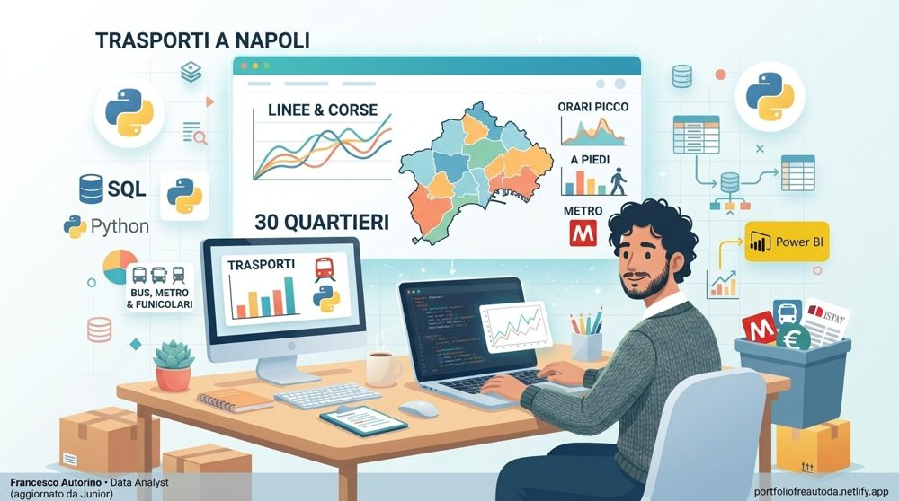</a>
 <b><a href="https://github.com/FreAuto/TrasportiNapoliQuartieri">🚌 Trasporti a Napoli</a></b> ❓ I 30 quartieri di Napoli sono serviti allo stesso modo da bus e metro? 🛠️ SQL · Python · Power BI 📅 ottobre 2026
</td>
</tr>
<tr>
<td width="50%" valign="top">
<a href="https://github.com/FreAuto/SperanzaDiVitaProvince">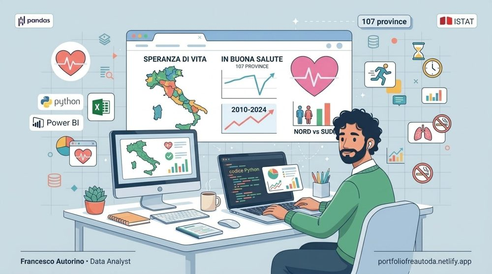</a>
 <b><a href="https://github.com/FreAuto/SperanzaDiVitaProvince">⏳ Speranza di vita</a></b> ❓ Dove si vive di più in Italia, e quanti anni in buona salute? 🛠️ Python · Excel · Power BI 📅 ottobre 2026
</td>
<td width="50%" valign="top">
<a href="https://github.com/FreAuto/BorseMondialiAnalisiIndici">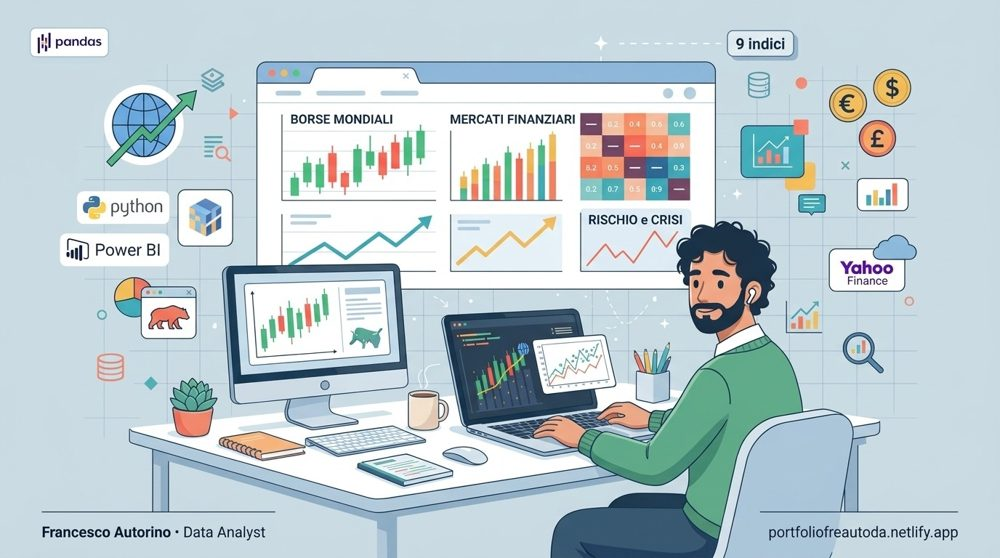</a>
 <b><a href="https://github.com/FreAuto/BorseMondialiAnalisiIndici">📈 Borse mondiali</a></b> ❓ Come sono andate le grandi Borse del mondo dal 2000 a oggi? 🛠️ Python · SQL · Power BI 📅 ottobre 2026
</td>
</tr>
<tr>
<td width="50%" valign="top">
<a href="https://github.com/FreAuto/PizzeriaAnalisiVendite">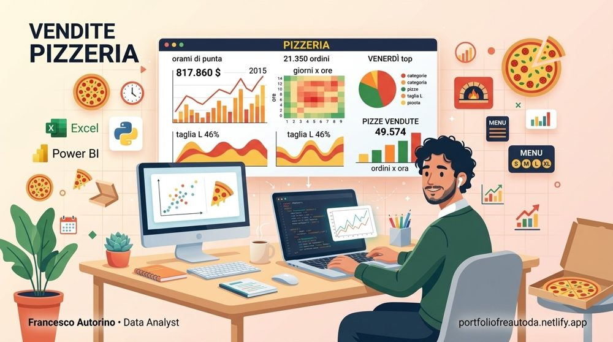</a>
 <b><a href="https://github.com/FreAuto/PizzeriaAnalisiVendite">🍕 Pizzeria</a></b> ❓ Quali pizze e quali orari portano più vendite? 🛠️ Excel · Power BI 📅 ottobre 2026
</td>
<td width="50%" valign="top">
<a href="https://github.com/FreAuto/SpiderManAnalisiMedia">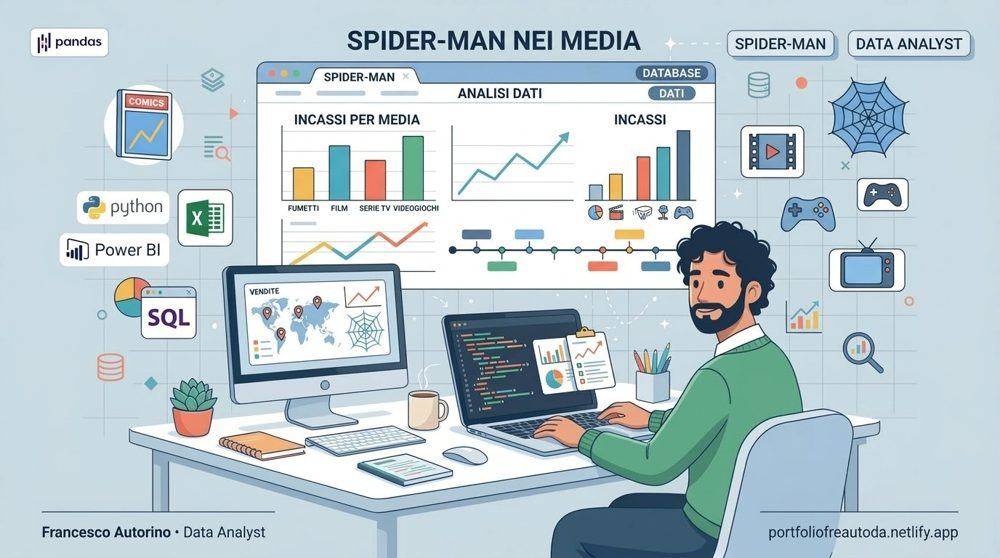</a>
 <b><a href="https://github.com/FreAuto/SpiderManAnalisiMedia">🕷️ Spider-Man nei media</a></b> ❓ Come è cresciuto Spider-Man dai fumetti a film, serie TV e videogiochi? 🛠️ Excel · SQL · Python · Power BI 📅 ottobre 2026
</td>
</tr>
<tr>
<td width="50%" valign="top">
<a href="https://github.com/FreAuto/FreAuto-MasterEpicode">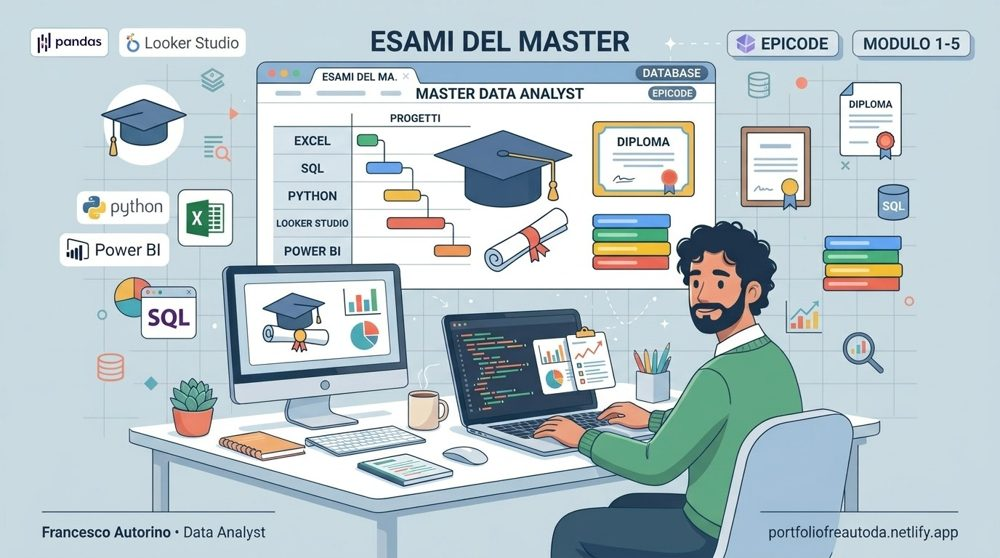</a>
 <b><a href="https://github.com/FreAuto/FreAuto-MasterEpicode">📚 Esami del Master EPICODE</a></b> ❓ Gli esami finali dei 6 moduli del corso 🛠️ Excel · SQL · Python · Power BI · Looker Studio 📅 marzo – settembre 2026
</td>
<td width="50%" valign="top">

 <b><a href="https://github.com/FreAuto/Progetti-Freecodecamp-Python">🐍 5 progetti freeCodeCamp</a></b> ❓ Statistica, dati demografici, dati medici, serie storiche e livello del mare 🛠️ Python · pandas · Seaborn · SciPy 📅 novembre 2026
</td>
</tr>
</table>

📌 In ogni progetto trovi un **README** con le fonti, i passaggi, i risultati e i limiti.

📄 Ogni dashboard Power BI c'è anche in **PDF**: si apre senza Power BI.

---

## 🔥 Progetti freeCodeCamp – Data Analysis with Python

📂 Tutti nel repository [Progetti-Freecodecamp-Python](https://github.com/FreAuto/Progetti-Freecodecamp-Python).

| Progetto | La domanda | Strumenti |
|---|---|---|
| 📐 Calcolatore statistico | Come calcolare in automatico media, varianza e deviazione standard di una matrice 3x3? | Python · NumPy |
| 👥 Dati demografici | Chi guadagna più di 50K all'anno, in base a età, istruzione, sesso e paese? | Python · Pandas |
| ❤️ Dati medici | Che legame c'è tra malattie cardiovascolari, BMI ed esami del sangue? | Pandas · Seaborn · Matplotlib |
| 📅 Visite al sito nel tempo | Quanto crescono le visite al forum ogni anno, e in quali mesi sono di più? | Pandas · Matplotlib · Seaborn |
| 🌊 Livello del mare | Quanto salirà il livello del mare entro il 2050? | Pandas · Matplotlib · SciPy |

---

## 🧰 Cosa so fare

| Strumento | Cosa ci faccio |
|---|---|
| 📗 **Excel** | Tabelle pivot, formule, menu a tendina, fogli di controllo |
| 🗄️ **SQL** | Database SQLite, JOIN, CTE, viste, funzioni finestra (RANK, LAG), schemi concettuali e logici |
| 🐍 **Python** | pandas, matplotlib, geopandas, scipy, scikit-learn, notebook Jupyter |
| 📊 **Power BI** | Modelli dati, misure DAX, dashboard con filtri e stili su misura |
| 📈 **Looker Studio** | Report e dashboard online |

---

## 🏅 I miei certificati

🎓 Prima il diploma EPICODE, poi gli altri in ordine di importanza.

| Ente | Cosa | Quanti | Data |
|---|---|---|---|
| 🎓 EPICODE | Diploma Data Analytics & AI + 6 moduli | 7 | 02/11/2026 |
| 📊 Google | Google Analytics Certification (100%) | 1 | 17/11/2026 |
| 🔥 freeCodeCamp | Data Analysis with Python + 5 progetti | 1 | 17/11/2026 |
| 🔷 IBM SkillsBuild | Data Analytics Fluency Pathway completo | 8 | 11-16/11/2026 |
| 🐍 Cisco Networking Academy | Data Analytics, Python 1 e 2, Data Science, AI | 5 | 16-17/11/2026 |
| 🏅 Kaggle Learn | SQL, Python, pandas, machine learning | 13 | 03-05/11/2026 |
| 🤖 Anthropic Academy | Claude e AI Fluency | 8 | 11/11/2026 |
| 💼 HP LIFE | Data Science, AI, CV e colloquio | 3 | 17/11/2026 |
| 🏢 Saylor University | Introduction to Business (88,37%) | 1 | 18/11/2026 |

👉 [Vedi tutti i certificati nel portfolio](https://portfoliofreautoda.netlify.app/#certificati)

---

## 🏅 Diploma e certificati EPICODE – Data Analytics & AI (2026)

🎓 **Diploma Data Analytics & AI** – rilasciato il **02/11/2026**

| Modulo | Argomento | Data |
|---|---|---|
| M6 | 📊 Microsoft Power BI | 21/09/2026 |
| M5 | 📈 Looker Studio | 02/08/2026 |
| M4 | 🐍 Python / Scraping | 12/07/2026 |
| M3 | 🗄️ SQL / RDBMS | 06/06/2026 |
| M2 | 📗 Excel / Pivot | 01/05/2026 |
| M1 | 📂 CSV / XML / Open Data | 30/03/2026 |

👉 [Vedi il diploma e i certificati nel portfolio](https://portfoliofreautoda.netlify.app/#certificati)

---

## 📊 Certificazione Google Analytics

Ho superato l'esame ufficiale **Google Analytics Certification (2026)** su Google Skillshop con il **100%**. 🎉

| Certificazione | Argomenti | Data | Scadenza |
|---|---|---|---|
| 📊 Google Analytics Certification (2026) | Modello dati a eventi, report, esplorazioni, attribuzione, integrazioni | 17/11/2026 | 17/11/2027 |

🆔 ID certificato: **200702438**

---

## 🔥 Certificazione freeCodeCamp

Ho ottenuto la certificazione **Data Analysis with Python** di freeCodeCamp (circa 300 ore di lavoro). 🎉

Per averla ho completato **5 progetti** in Python, che trovi più sopra e nel repository [Progetti-Freecodecamp-Python](https://github.com/FreAuto/Progetti-Freecodecamp-Python).

🔗 [Verifica il certificato](https://freecodecamp.org/certification/freauto/data-analysis-with-python-v7)

| Certificazione | Argomenti | Data |
|---|---|---|
| 🔥 Data Analysis with Python | NumPy · Pandas · Matplotlib · Seaborn · SciPy | 17/11/2026 |

---

## 🔷 Badge IBM SkillsBuild (8)

Ho ottenuto **8 badge digitali** di IBM SkillsBuild, verificati su Credly. 🎉

Ho completato tutto il **Data Analytics Fluency Pathway** (6 microcredenziali, 16/11/2026). 🏆

🔗 [Verifica i badge sul mio profilo Credly](https://www.credly.com/users/francesco-autorino.98)

| Badge | Corsi inclusi | Data |
|---|---|---|
| 📥 Data Collection and Analysis | Data Analytics Fluency Pathway – Microcredenziale 4 | 16/11/2026 |
| 🧹 Data Preparation for Analysis | Data Analytics Fluency Pathway – Microcredenziale 5 | 16/11/2026 |
| 📈 Data Visualization and Presentation | Data Analytics Fluency Pathway – Microcredenziale 6 | 16/11/2026 |
| 🧮 Introduction to Inferential and Descriptive Statistics | Data Analytics Fluency Pathway – Microcredenziale 3 | 16/11/2026 |
| 🗂️ Data Classification | Data Analytics Fluency Pathway – Microcredenziale 1 | 14/11/2026 |
| 🏢 Data Usability for Organizations | Data Analytics Fluency Pathway – Microcredenziale 2 | 14/11/2026 |
| 🩷 Data Fundamentals | Data Science Methodologies · Clean, Refine and Visualize Data with IBM Watson Studio · Your Future in Data | 11/11/2026 |
| 📊 Getting Started with Data | Introduction to Data Concepts · Data Science Landscape · Introduction to Tableau Desktop | 11/11/2026 |

👉 [Vedi tutti i certificati nel portfolio](https://portfoliofreautoda.netlify.app/#certificati)

---

## 🐍 Badge Cisco Networking Academy (5)

Ho completato **5 corsi** di Cisco Networking Academy, ognuno con l'esame finale. 🎉

🔗 [Verifica i badge sul mio profilo Credly](https://www.credly.com/users/francesco-autorino.98)

| Badge | Argomenti | Data |
|---|---|---|
| 📊 Data Analytics Essentials | Ciclo di vita dell'analisi, Excel, statistica, SQL, Tableau, etica dei dati | 17/11/2026 |
| 🐍 Python Essentials 2 | Moduli e pacchetti, eccezioni, stringhe, programmazione a oggetti, file | 17/11/2026 |
| 🔬 Introduction to Data Science | Cos'è la data science, dati, analisi e machine learning | 17/11/2026 |
| 🤖 Introduction to Modern AI | Intelligenza artificiale moderna, machine learning e AI generativa | 17/11/2026 |
| 🐍 Python Essentials 1 | Variabili, operatori, cicli, liste, funzioni, tuple, dizionari, eccezioni | 16/11/2026 |

👉 [Vedi tutti i certificati nel portfolio](https://portfoliofreautoda.netlify.app/#certificati)

---

## 🏅 Certificati Kaggle Learn (13)

Ho completato **13 corsi** di Kaggle Learn, la piattaforma di formazione di Kaggle (Google). 🎉

| # | Corso | Data |
|---|---|---|
| 1 | 🗄️ Advanced SQL | 05/11/2026 |
| 2 | ⏱️ Time Series | 05/11/2026 |
| 3 | 🤖 Intermediate Machine Learning | 05/11/2026 |
| 4 | 🔍 Machine Learning Explainability | 05/11/2026 |
| 5 | 🐍 Intro to Programming | 04/11/2026 |
| 6 | ⚖️ Intro to AI Ethics | 04/11/2026 |
| 7 | 🗄️ Intro to SQL | 03/11/2026 |
| 8 | 🐍 Python | 03/11/2026 |
| 9 | 🐼 Pandas | 03/11/2026 |
| 10 | 🧹 Data Cleaning | 03/11/2026 |
| 11 | 📊 Data Visualization | 03/11/2026 |
| 12 | 🤖 Intro to Machine Learning | 03/11/2026 |
| 13 | 🛠️ Feature Engineering | 03/11/2026 |

👉 [Vedi tutti i certificati nel portfolio](https://portfoliofreautoda.netlify.app/#certificati)

---

## 🤖 Certificati Anthropic Academy (8)

Ho completato **8 corsi** di Anthropic Academy, la piattaforma ufficiale di Anthropic (Claude) sull'uso dell'AI. 🎉

| # | Corso | Data |
|---|---|---|
| 1 | 🍎 Claude 101 | 11/11/2026 |
| 2 | 💻 Claude Code 101 | 11/11/2026 |
| 3 | 🗂️ Introduction to Claude Cowork | 11/11/2026 |
| 4 | 🧭 AI Fluency: Framework & Foundations | 11/11/2026 |
| 5 | ⚖️ AI Capabilities and Limitations | 11/11/2026 |
| 6 | 🎓 AI Fluency for Students | 11/11/2026 |
| 7 | 🏢 AI Fluency for Small Businesses | 11/11/2026 |
| 8 | 🛠️ AI Fluency for Builders | 11/11/2026 |

👉 [Vedi tutti i certificati nel portfolio](https://portfoliofreautoda.netlify.app/#certificati)

---

## 💼 Attestati HP LIFE (3)

Ho completato **3 corsi gratuiti** di HP LIFE, il programma di formazione della HP Foundation. 🎉

| Corso | Argomenti | Data |
|---|---|---|
| 📊 Data Science & Analytics | Metodi e strumenti della data science, vantaggi e sfide di un'azienda guidata dai dati | 17/11/2026 |
| 🤖 AI for Business Professionals | Strumenti AI standalone e integrati, prompt efficaci, uso etico dell'AI | 17/11/2026 |
| 📝 Resume Writing and Job Interviewing | CV e lettera di presentazione su misura, preparazione al colloquio | 17/11/2026 |

---

## 🏢 Certificato Saylor University

Ho completato il corso **BUS101: Introduction to Business** di Saylor University. 🎉

| Corso | Ore | Voto | Data |
|---|---|---|---|
| 🏢 BUS101: Introduction to Business | 62 ore · 6,5 CEU (IACET) | **88,37%** | 18/11/2026 |

🆔 ID certificato: **9866376849FA**

---

## 🌍 Lingue

🇮🇹 Italiano: madrelingua

🇬🇧 Inglese: **B2** – EF SET 60/100 (novembre 2026)

---

## 📫 Contatti

📄 CV: [scarica il PDF](https://portfoliofreautoda.netlify.app/Francesco_Autorino_CV.pdf)

💼 LinkedIn: [Francesco Autorino](https://www.linkedin.com/in/francesco-autorino-3544b1447/)

💬 Telegram: [@FreAutoBD1298](https://t.me/FreAutoBD1298)

✉️ Email: [autorinofrancesco.da@gmail.com](mailto:autorinofrancesco.da@gmail.com)
